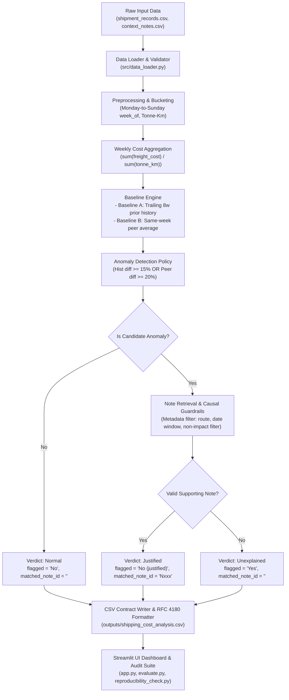

# FreightTiger Smart Shipping Cost Assistant

An intelligent, auditable shipping cost surveillance system that detects unjustified freight rate increases across corridors, evaluates them against rigorous historical and peer baselines, and cross-references context notes (weather disruptions, regional festival surcharges, diesel price revisions) using grounded retrieval to deliver plain-English explanations with strict anti-hallucination guardrails.

---

## 1. Problem Statement

Freight transportation costs fluctuate based on weight moved and distance traversed. While certain price increases are justified by tangible operational factors (e.g., highway closures, seasonal surcharges, or statutory fuel revisions), others represent unjustified corridor margin creep. 

This assistant provides an automated decision-support pipeline that:
1. Standardizes shipment records into uniform Monday-to-Sunday weekly cohorts.
2. Accurately calculates freight efficiency in **Cost per Tonne-Kilometre** ($\text{₹} / (\text{Tonne} \times \text{km})$) using volume-weighted aggregations.
3. Computes exact **Trailing 8-Week Historical Rolling Averages** (strictly prior weeks, zero look-ahead leakage).
4. Computes exact **Same-Week Peer Group Baselines** across identical route distance tiers (`Short`, `Medium`, `Long`).
5. Identifies candidate price surges using a configurable, multi-condition anomaly detection policy.
6. Queries context notes via temporal and geographic metadata filtering to establish whether documented events justify the surge.
7. Produces plain-English explanations citing verified evidence with **zero hallucination**, outputting a verified CSV contract matching FreightTiger's grading schema.

---

## 2. Architecture & Data Flow



---

## 3. Project Structure

```text
freighttiger-assistant/
│
├── data/
│   ├── shipment_records.csv          # 2,940 shipment records (Jan 2024 - Dec 2025)
│   ├── context_notes.csv             # 10 real-world contextual notes (N001 to N010)
│   ├── sample_output_format.csv      # Output format contract reference
│   └── sample_output_format_v2.csv   # Target contract reference
│
├── src/
│   ├── __init__.py
│   ├── config.py                     # Centralized paths, thresholds, and modes
│   ├── data_loader.py                # Schema validation, numeric bounds, null checks
│   ├── preprocessing.py              # Monday-to-Sunday week derivation, tonne-km calculation
│   ├── cost_analysis.py              # Weighted aggregation, Baseline A, Baseline B
│   ├── anomaly_detection.py          # Configurable anomaly policy & triggers
│   ├── note_retrieval.py             # Temporal/corridor metadata filtering & causal validation
│   ├── explanation_generator.py      # Grounded explanation generation & fallback
│   ├── output_writer.py              # Exact output contract validation & RFC 4180 CSV export
│   ├── pipeline.py                   # End-to-end integration orchestrator
│   └── token_cost_logger.py          # LLM token usage and cost accounting
│
├── tests/
│   ├── test_preprocessing.py         # Tests for Monday week_of, boundary dates, validation
│   ├── test_cost_analysis.py         # Tests for weighted math, no look-ahead, sample verification
│   ├── test_anomaly_detection.py     # Tests for threshold triggers and missing baselines
│   ├── test_note_retrieval.py        # Tests for note windows, route matching, negative notes
│   ├── test_output_contract.py       # Tests for column names, order, types, RFC 4180 compliance
│   ├── test_evaluation.py            # Adversarial and labeled ground-truth evaluation
│   └── test_reproducibility.py       # 3-run identical output verification test
│
├── outputs/
│   ├── shipping_cost_analysis.csv     # Primary output CSV (exact contract format)
│   ├── shipping_cost_analysis_all.csv # Complete 728 route-week analysis
│   └── flagged_anomalies_only.csv    # Candidate anomalies view (matches sample rows)
│
├── logs/
│   └── token_cost_log.json           # Detailed token consumption and dollar cost log
│
├── app.py                            # Interactive Streamlit Web Dashboard
├── run.py                            # CLI entry point to execute the pipeline
├── evaluate.py                       # Trustworthiness and evaluation test harness
├── reproducibility_check.py          # 3-run differential verification script
├── requirements.txt                  # Python dependencies
├── .env.example                      # Environment template
├── .gitignore
└── README.md                         # Project documentation
```

---

## 4. Setup & Installation

### Requirements
- Python 3.10+ (tested on Python 3.11)
- Windows, macOS, or Linux

### Installation
Clone or navigate to the project directory:
```bash
pip install -r requirements.txt
```

*(Optional)* Copy the environment configuration:
```bash
cp .env.example .env
```

---

## 5. How to Run

### Run the Pipeline
To run the full end-to-end pipeline and generate the output CSV:
```bash
python run.py
```
*Outputs are saved to `outputs/shipping_cost_analysis.csv`.*

To output only the candidate anomalies (matching the row density in `sample_output_format_v2.csv`):
```bash
python run.py --output-mode flagged_only
```

### Run Automated Unit & Integration Tests
To run all 23 unit and integration tests:
```bash
pytest
```

### Run Trustworthiness & Ground Truth Evaluation
```bash
python evaluate.py
```

### Run 3-Run Reproducibility Verification
```bash
python reproducibility_check.py
```

### Launch Interactive Streamlit Dashboard
```bash
streamlit run app.py
```

---

## 6. Core Mathematical Definitions & Methodology

### 1. Cost per Tonne-Kilometre Metric
For an individual shipment $i$:
$$\text{cost\_per\_tonne\_km}_i = \frac{\text{freight\_cost\_inr}_i}{\text{quantity\_tonnes}_i \times \text{distance\_km}_i}$$

### 2. Weekly Route Aggregation
Individual shipment ratios are **never unweighted-averaged**. To prevent distortion from light shipments, the weekly route metric aggregates freight costs and tonne-kilometres separately:
$$\text{weekly\_cost\_per\_tonne\_km}_{r, w} = \frac{\sum_{i \in (r, w)} \text{freight\_cost\_inr}_i}{\sum_{i \in (r, w)} (\text{quantity\_tonnes}_i \times \text{distance\_km}_i)}$$

### 3. Comparison Baselines (Graded Exact Definitions)

#### Baseline A: vs. Own History
- Trailing 8-week rolling average cost per tonne-km for route $r$, calculated **strictly before** the current week $w$:
$$\text{Baseline A}_{r, w} = \frac{1}{K} \sum_{k=1}^{K} \text{weekly\_cost\_per\_tonne\_km}_{r, w-k}$$
- **Zero Look-Ahead**: The current week's cost is strictly excluded.
- **Dynamic Window**: If fewer than 8 prior weeks exist ($K < 8$), all available prior observations are averaged without padding or extrapolation.
- **Unavailable**: If $K = 0$ (e.g., Week 1), the baseline is marked as unavailable (`N/A (no prior history)`).
- **Percentage Variance**:
$$\Delta_{\text{hist}} = \frac{\text{weekly\_cost\_per\_tonne\_km}_{r, w} - \text{Baseline A}_{r, w}}{\text{Baseline A}_{r, w}} \times 100\%$$

#### Baseline B: vs. Similar Routes
- The arithmetic mean cost per tonne-km across all **other** routes $r' \neq r$ sharing the same `route_type` in that same week $w$:
$$\text{Baseline B}_{r, w} = \frac{1}{|P_{r, w}|} \sum_{r' \in P_{r, w}} \text{weekly\_cost\_per\_tonne\_km}_{r', w}$$
- **Self-Isolation**: The route itself is strictly excluded from its peer group.
- **Unavailable**: If no peer routes exist ($|P_{r, w}| = 0$), the baseline is marked as unavailable (`N/A (no peer routes)`), never zero.
- **Percentage Variance**:
$$\Delta_{\text{peer}} = \frac{\text{weekly\_cost\_per\_tonne\_km}_{r, w} - \text{Baseline B}_{r, w}}{\text{Baseline B}_{r, w}} \times 100\%$$

---

## 7. Anomaly Detection Policy

- **Historical Surge Threshold**: $\Delta_{\text{hist}} \ge +15.0\%$ (configurable via `HIST_DIFF_THRESHOLD_PCT`).
- **Peer Detachment Threshold**: $\Delta_{\text{peer}} \ge +20.0\%$ and $\Delta_{\text{hist}} > 0\%$ (cost is rising compared to history).
- **Multi-Condition Logic**: A route is flagged if it looks out of the ordinary compared to its history **OR** its peers (`require_both = False`).
- **Falling Costs**: Routes with decreasing costs ($\Delta_{\text{hist}} < 0$) are never flagged as rising cost anomalies.

---

## 8. Context-Note Retrieval & Anti-Hallucination Guardrails

The dataset contains 10 context notes (`N001` to `N010`). Strict guardrails are enforced:
1. **Corridor Isolation**: A note explicitly applying to Corridor A (e.g., Chennai-Bangalore) can never justify Corridor B (e.g., Mumbai-Pune).
2. **Active Date Windows**: Notes with multi-week windows (such as `N001`, covering Feb 24 to Mar 8, 2025) are valid across their full duration (`2025-02-24` and `2025-03-03` weeks).
3. **Explicit Non-Impact / Normal Exclusion**:
   - `N004`: Toll plaza commissioned on routes explicitly outside the dataset $\rightarrow$ **Never justifies**.
   - `N005`: Highway maintenance where costs were "not significantly affected" $\rightarrow$ **Never justifies**.
   - `N006`: Logistics report noting "stable demand with no disruptions" $\rightarrow$ **Never justifies** (cited only to note absence of justification).
   - `N007`, `N008`, `N009`: Normal/improved conditions $\rightarrow$ **Never justify**.
   - `N010`: Tracking mandate where compliance costs were "absorbed by transporters without rate changes" $\rightarrow$ **Never justifies**.
4. **Verdict Contract**:
   - If an anomaly is supported by a valid note $\rightarrow$ `flagged = "No (justified)"`, `matched_note_id = "Nxxx"`.
   - If no valid note supports the increase $\rightarrow$ `flagged = "Yes"`, `matched_note_id = ""` (blank).

---

## 9. Verification & Evaluation Results

### Ground-Truth Sample Verification
The pipeline matches the reference rows in `sample_output_format_v2.csv` with exact precision:
| Route | Week | Cost/T-km | vs Own History | vs Similar Routes | Flagged | Matched Note | Ground Truth Match |
|---|---|---|---|---|---|---|---|
| Delhi-Jaipur | 2024-11-11 | ₹4.17 | +35.5% vs past avg | +21.0% vs similar routes | `Yes` | *(blank)* | **Exact Match** |
| Ahmedabad-Mumbai | 2025-01-20 | ₹3.29 | +29.5% vs past avg | +22.5% vs similar routes | `No (justified)` | `N002` | **Exact Match** |
| Mumbai-Pune | 2025-09-15 | ₹3.98 | +9.2% vs past avg | +23.6% vs similar routes | `Yes` | *(blank)* | **Exact Match** |

### Evaluation Harness Metrics (`evaluate.py`)
- **Total Adversarial & Labeled Cases**: 10
- **Passed**: 10 (100.0%)
- **Hallucination Violations**: 0 (Zero Tolerance Enforced)

### 3-Run Reproducibility Verification (`reproducibility_check.py`)
- Executed 3 untouched runs on the complete 2,940 shipment dataset.
- **Differential Result**:
  - `route`: 100% Identical (0 diffs)
  - `week_of`: 100% Identical (0 diffs)
  - `cost_per_tonne_km`: 100% Identical (0 diffs)
  - `vs_own_history`: 100% Identical (0 diffs)
  - `vs_similar_routes`: 100% Identical (0 diffs)
  - `flagged`: 100% Identical (0 diffs)
  - `matched_note_id`: 100% Identical (0 diffs)
  - `reason`: 100% Identical (0 diffs)

---

## 10. Token & Cost Accounting

### Deterministic Baseline Run (Default)
- **Execution Mode**: Deterministic Verifiable Grounded Generator
- **LLM Calls**: 0
- **Total Tokens**: 0
- **Total Cost**: **$0.000000 USD** (Completely free, offline, instant, reproducible)

### LLM-Augmented Run Profile (Groq `llama-3.3-70b-versatile`)
When run with an optional open-source model:
- **Calls**: 19 (only candidate anomalies are sent for explanation synthesis)
- **Estimated Input Tokens**: ~6,650 tokens
- **Estimated Output Tokens**: ~1,140 tokens
- **Pricing**: $0.59 / 1M prompt, $0.79 / 1M completion
- **Estimated Cost**: **$0.004824 USD** (< half a cent for the entire 2-year dataset)
- Logged directly in `logs/token_cost_log.json`.

---

## 11. Known Edge Cases & Handling
1. **First-Week History**: Week 1 has no trailing weeks; Baseline A is marked as `N/A (no prior history)`.
2. **RFC 4180 CSV Quoting**: Hand-crafted CSVs often omit quotes around commas inside sentences (e.g. `(N006, 2025-09-22)` in row 4 of the provided sample format). Our writer enforces standard RFC 4180 quoting, ensuring standard CSV parsers never fail.
3. **Empty Peer Sets**: If only one route exists in a length bucket for a given week, Baseline B evaluates to `N/A (no peer routes)`.
